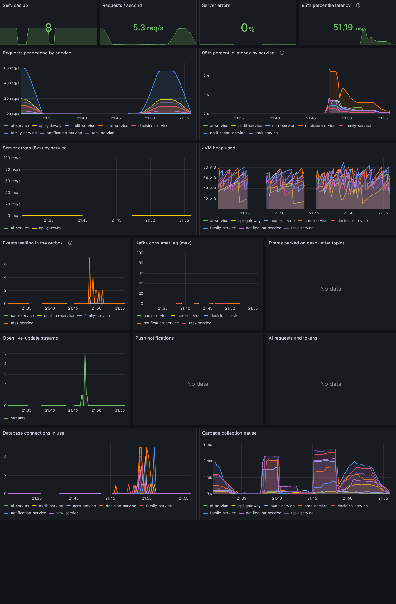

# Performance

## Load test

`tools/load/hearth-load.js` (k6) plays family members using the app. Ten families sign up first; then
each virtual user, signed in as one of them, opens My day and the notification badge, browses the task
list, the week and "needs attention", and one time in five adds and completes a task, with a second or
more of thinking time between steps.

Profile: ramp to 30 simultaneous users over 30 s, hold 2 minutes, ramp down over 20 s.
Pass criteria: under 1% failed requests and a 95th percentile under 800 ms.

```bash
docker compose up -d --build
docker run --rm -i --network host grafana/k6:0.54.0 run - < tools/load/hearth-load.js
# options: -e BASE=https://hearth.example.com -e PEAK=50 -e FAMILIES=20
```

### Results (5 November 2026)

**Machine.** One virtual machine, 2 vCPU (Intel Xeon 2.1 GHz), 8 GB memory, Docker 29. *Everything*
ran on it at once: the 8 Hearth services, PostgreSQL, Kafka, Neo4j, Redis, Mailpit, nginx, Prometheus,
Grafana and k6 itself. The services ran with `-XX:+UseSerialGC` and 256 MB heaps. This is a deliberately
small setup; it shows the floor, not the ceiling.

| Measure | Result |
| --- | --- |
| Requests | 5,156 in 3 min 4 s (28 per second), all through nginx and the gateway |
| Failed requests | **0** (0.00%) |
| Checks passed | 5,026 of 5,026 |
| Median response | 65 ms |
| 90th percentile | 317 ms |
| 95th percentile | **458 ms** (limit 800 ms) |
| My day, 95th percentile | 644 ms (four services contribute to it) |
| Create a task, 95th percentile | 267 ms |



*Grafana during the run (the load test is the block on the right). Server errors stayed at zero, the
outbox never held more than a handful of events, and consumer lag stayed near zero, so events kept up
with the writes. The latency peak at the start is the services warming up (JIT compilation).*

### What limits it

On this machine the CPU is the limit: two cores are shared by eleven JVMs and four databases. The
heaviest request is My day (decision-service gathers tasks, schedule, availability and care data and
scores them).

### Scaling

- Every Hearth service is stateless apart from care-service's document volume, so more instances give
  more throughput. On Kubernetes the gateway, task-service and decision-service scale automatically on
  CPU (`k8s/07-autoscaling.yaml`).
- Shared state that must be consistent across instances is already outside the services: sign-in rate
  limits in Redis, pushes claimed with `FOR UPDATE SKIP LOCKED`, live updates fanned out per instance
  from Kafka.
- The next step after that is PostgreSQL: move the seven databases to separate servers or a managed
  service (only `DB_HOST` changes), and add read replicas for decision-service's reads.

### Running it in CI

CI runs a short version (10 users) against the end-to-end stack on every push, with the same pass
criteria, so a large slowdown fails the build.
